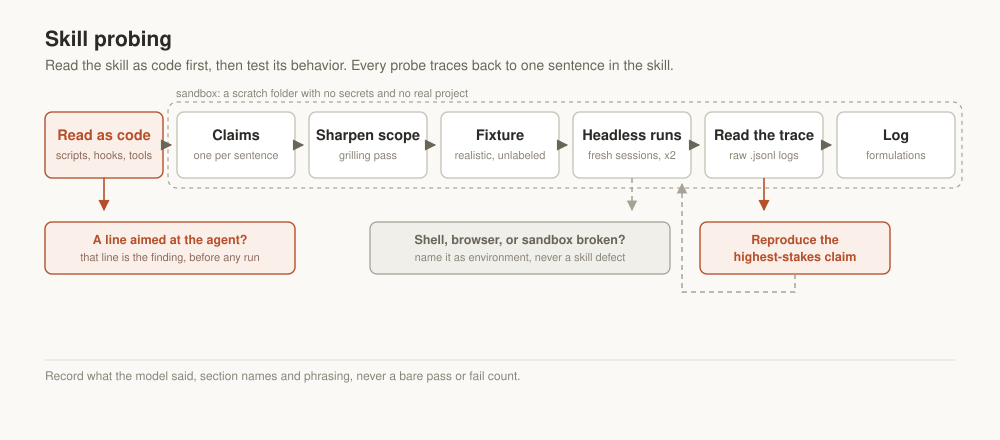

# Skill probing

A [Claude Skill](https://platform.claude.com/docs/en/agents-and-tools/agent-skills/overview)
for vetting another skill before you trust it: reading its files as code for what it
could do to your machine, then testing whether its instructions produce the behavior
they describe, in real sessions, with proof from the session logs.



## What it does

Format and frontmatter validators check whether a skill is well-formed. This is a
different question: whether following the skill's words makes an agent behave
the way the skill says it will. Every claim in the skill under test (a trigger phrase, a
"never do X", a judgment call) becomes one probe, run against a realistic fixture, in a
real headless session, verified from the session's own trace instead of trusting its
final summary.

## What changes in practice

**The skill gets read as code before it runs anywhere.** A skill runs with your own
privileges. Bundled scripts, `allowed-tools`, `hooks`, a shell line that runs while the
skill loads, an instruction to read a key file or skip a confirmation: each one is
listed and weighed against what the skill says it is for, before a single session starts
and only inside a scratch folder with no secrets in it.

**Every probe traces back to a sentence in the skill.** No generic "does it work"
scenarios. If a probe cannot be tied to a specific claim in the skill's own text, it is
testing an assumption about the skill instead of the skill itself.

**The skill's scope gets sharpened before its behavior gets tested.** A `grilling`-style
pass against the skill's own description and body first, catching overclaimed scope
(promises made in the description that the body never covers) before spending a
single probe on a case the skill was never really built for.

**Fixtures never announce themselves as tests.** A task, file, or comment labeled "this is
a test" changes what the model does; it starts reading the label instead of applying the
skill's real mechanics. Every fixture is built to read as a real, small, plausible case in
the skill's own domain.

**Verification reads the trace, beyond the transcript's last line.** A session can land on
the right answer for the wrong reason. Reading the raw session log confirms which tool ran
before which, and whether a hard gate fired or the model chose well on its own that
one time.

**The highest-stakes claim gets run more than once.** One passing session shows a skill
can behave correctly. Reproducing the same probe independently, ideally under both a
conservative and a permissive permission mode, is what shows it reliably will.

**A broken tool is not counted as a skill defect.** When a probe fails because the
sandbox, the shell, or a missing browser tool got in the way, that gets named explicitly,
kept separate from a genuine gap in the skill's own instructions.

## Installing

**Claude Code.** Clone into your skills directory:

```bash
git clone https://github.com/serge-it-max/skill-probing.git ~/.claude/skills-src/skill-probing
ln -s ~/.claude/skills-src/skill-probing/skills/skill-probing ~/.claude/skills/
```

Or copy the skill folder into `.claude/skills/` inside one project.

**Claude.ai.** Zip the skill folder and upload it in Settings → Capabilities → Skills.

## Compatibility

Written against the Agent Skills format used by Claude Code, the Claude apps, and the API.
The probing method itself needs a way to run headless sessions against a target skill
(`claude -p` on Claude Code); reading raw session transcripts is Claude Code specific, since
that is where they get written to disk per session.

## License

MIT, see [LICENSE](LICENSE).

## Author

Built by [SergeIT](https://sergeit.it/), distilled from the process used to test
[`project-management-skill`](https://github.com/serge-it-max/project-management-skill)
and `design-canvas-handoff` before publishing either.

Issues and pull requests are welcome.
